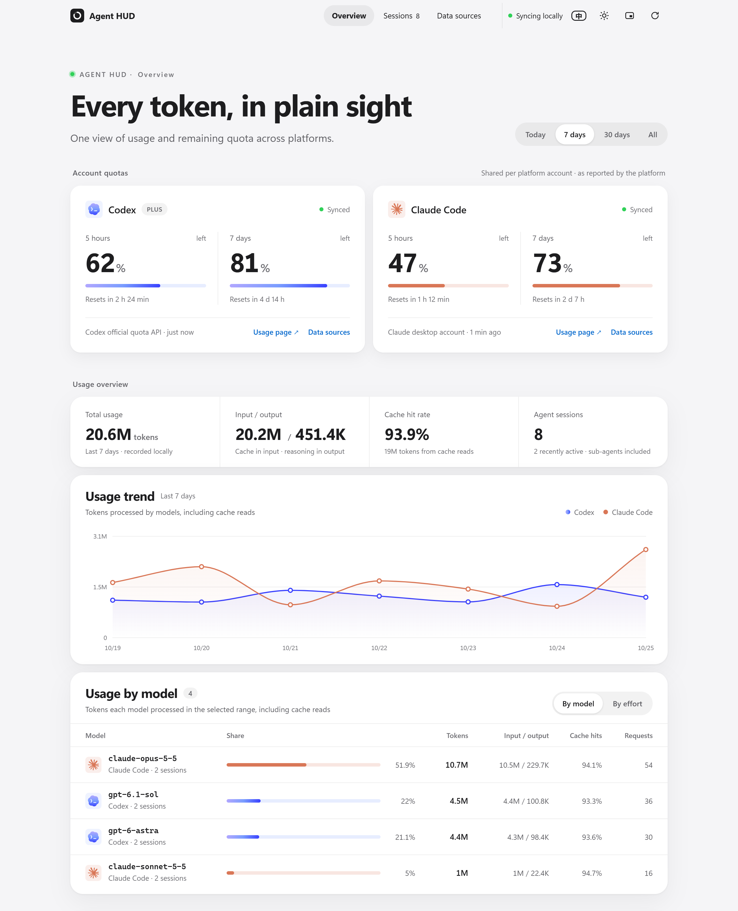

  

<h1 align="center">Agent HUD</h1>

  Codex + Claude Code usage and quota at a glance — a local dashboard and a glassy Windows desktop widget.

  
  
  
  

  English | <a href="README.zh-CN.md">简体中文</a>

  

  <picture>
    <source media="(prefers-color-scheme: dark)" srcset="docs/images/dashboard-dark-en.png">
    
  </picture>
   
  Screenshots use demo data.

## Highlights

- 🪟 **Desktop widget** — a frosted-glass strip that blurs what's behind it, with brand-colored rings, the remaining percentage and when each quota resets.
- 📊 **Dashboard** — account quotas, token usage, cache hit rate, a seven-day chart, usage by model or thinking effort, and every agent session, in light or dark.
- 🔒 **Local only** — reads your own Codex / Claude Code logs, binds to 127.0.0.1, never stores prompts or credentials.
- 📌 **Stays out of the way** — one-click pin, snaps to screen edges, restarts its own service if it stops.
- 🌐 **English / 中文** — the dashboard follows your browser language and the widget your Windows language; both switch with one click.

## Quick start

You need Windows 10/11, Node.js 22+ (24.5+ recommended on Windows), and Codex and/or Claude Code used on this machine.

**Dashboard:** right-click `start.ps1` and choose *Run with PowerShell*, or run `powershell -ExecutionPolicy Bypass -File .\start.ps1` in the project folder. It starts the service in the background and opens your browser; `stop.ps1` stops the service it started. You can also run `node server.mjs` directly, open http://127.0.0.1:4318, and press Ctrl+C to stop. Set the `PORT` environment variable to use another port.

**Desktop widget:** build it with `powershell -ExecutionPolicy Bypass -File desktop/build.ps1`, then launch `desktop\bin\AgentHUD.exe` (you can pin a shortcut to it on the desktop or taskbar). The widget starts the local service by itself, so you don't need to run `start.ps1` first.

The dashboard's top-right corner switches language (EN / 中), switches appearance (system / light / dark) and opens a compact window (whether it stays on top is up to your OS/browser). The language follows your browser until you pick one, and the choice is saved; status text sent by the local service is translated too.

## Data and counting

- Codex: incrementally reads `~/.codex/sessions/**/*.jsonl` and takes titles from `session_index.jsonl`. Uses per-request `token_usage_record` usage when present, falling back to diffs of cumulative `token_count` values on older versions. Deduplicates by response ID, excludes records inherited from other threads, and recognizes parent/child agents.
- Claude Code: incrementally reads `~/.claude/projects/**/*.jsonl`. Merges streamed records of the same response by message ID, deduplicates across copied/resumed sessions, and reads sub-agent files.
- Input includes cache reads and writes; output includes reasoning. Cache and reasoning are never added to the total a second time. The cross-platform total is `input + output`.
- *Usage by model* adds up each request under the model that served it, so a session that switched models is split between them. It follows the time range, platform filter and system-agent switch.
- *By effort* groups the same requests by thinking effort instead, as each client recorded it: Claude Code writes the level on every reply, Codex on every turn. Levels stay per platform (Codex `xhigh` and Claude Code `xhigh` are separate rows). The thinking-tokens column is the reasoning share of output; requests from client versions that didn't record a level show as *Not recorded*.
- System review agents are hidden by default; turn them on below the table. Their token records do not equal subscription quota usage.
- Counts cover sessions on this machine that haven't been archived. It is not all of your cloud activity and not a bill. "Recently active" means a record in the last 2 minutes, not process detection.
- Date ranges and charts use the America/New_York time zone. Account quotas always follow each platform's own windows and ignore the token date filter.

## Codex account quota

Refreshed every minute through the official App Server's read-only `account/rateLimits/read`, without making model requests. It reuses Codex's own sign-in; the app never reads, stores or prints login secrets. When the connection fails it shows the real quota snapshot from your latest session, labelled with its source and time. Past the reset time it shows "waiting for update" instead of assuming 100%.

Set `CODEX_BINARY` to point at the Codex executable and `CODEX_HOME` to choose the sessions folder. `AGENT_HUD_DISABLE_RPC=1` uses local snapshots only.

Reference: [Codex App Server documentation](https://learn.chatgpt.com/docs/app-server).

## Windows desktop widget

The widget runs `desktop/bin/AgentHUD.exe` directly and brings the local quota service back on its own. Earlier versions launched through `Agent HUD.vbs` and `start-widget.ps1`, which antivirus software (Norton) quarantined, so the entry point no longer depends on scripts. On the first run of a freshly built exe, some antivirus products hold it for tens of seconds while scanning.

The widget is a 304 × 48 DIP frosted-glass strip: it blurs whatever is behind it live, uses Windows 11's native rounded corners, scales with Windows display scaling to roughly taskbar height, and follows the Windows app light/dark theme (matching the dashboard). With Windows transparency effects off it switches to an opaque background. The rings use each brand's colors (Codex's blue-violet gradient, Claude's clay orange) with the brand's mark in the center and the remaining percentage beside it; the percentage turns red below 20%.

Drag empty space to move it. On release it snaps to the edge of the screen's work area when close, and it remembers the monitor and relative position. Restored positions avoid the taskbar and gaps between monitors, are corrected after display or scaling changes, and fall back to the primary screen if the original one is gone. Both the ⋯ menu and the tray menu offer *Reset widget position*.

`5h` / `7d` on the right switches the quota window. Under each percentage is the quota's reset time: the clock time when it's within a day ("Resets 14:30"), otherwise the weekday ("Resets Thu", or "Next Thu" when it falls on the same weekday next week). It reads "Offline" when the local service is offline, and "Codex left" / "Claude left" when the platform gives no reset time. Hover a ring for when the quota was actually collected, how long ago that was, the reset countdown, the full date, and the source. Local snapshots are read every 5 seconds; Codex's official quota is normally queried about once a minute and Claude's desktop quota about every 5 minutes, and both may lag when connections fail. An unknown time is never shown as "just now".

A solid blue pin means always-on-top; a hollow pin with a slash means not pinned. Click the pin once to pin, again to unpin. The ⋯ to the right of `5h` / `7d` opens the menu: toggle always-on-top, open the dashboard or the Codex / Claude usage pages, hide to the tray, reset the position, or quit.

The widget comes in English and Chinese. By default it follows the Windows display language; the **EN** / **中** button left of the pin (or *Switch to English* / *切换到中文* in the tray menu) changes it on the spot, and the choice is saved. Status text that the local service sends (quota sources, connection messages) is translated too.

When the local service is offline the edge turns orange and the widget shows "Offline"; after two failed reads in a row it restarts the service with `start.ps1` (at most once a minute). Rings aren't redrawn when nothing changed; when hidden, the widget stops UI updates and animation but keeps fetching, and shows the latest snapshot as soon as it's restored. Tray and exit signals are event-driven rather than polled every second.

The visual design follows [apple-design-skill](https://github.com/naplesblue/apple-design-skill): a grey-white ground, white panels with hairline dividers, grayscale hierarchy with a single blue accent, and glass only on navigation, dialogs and the floating widget.

The desktop app builds with the .NET Framework that ships with Windows, so no extra runtime is needed. The launcher reuses the existing build and doesn't check sources or recompile. After changing the source, quit the widget from its menu, run `powershell -ExecutionPolicy Bypass -File desktop/build.ps1`, then start it again. The content fingerprinting, staging builds and ordered replacement in `desktop/build-support.ps1` remain for development and regression tests. Startup diagnostics go to `.data/widget-startup.log` and errors to `.data/widget-error.log`.

## Claude account quota

### Windows desktop account connection

The desktop account channel is off by default. It reads the current Windows user's encrypted Claude OAuth cache in memory only, matches the current account and its single organization, and sends a GET to the fixed address `https://api.anthropic.com/api/oauth/usage`. This quota is shared by the desktop app, web and CLI of the same account; it doesn't depend on status-line callbacks and makes no model requests.

Once you explicitly allow the connection, run `node scripts/connect-claude-desktop.mjs --enable` and restart the HUD service. Turn it off with `--disable` on the same command. The switch is stored in this project's `.data/claude-desktop-connection.json`; while it's absent, no credentials are read and no Claude quota is requested.

It normally queries every 5 minutes and waits at least 15 minutes when rate limited. HUD doesn't store access tokens, log raw responses, change Claude's configuration, or refresh or rotate tokens; when the connection expires, open Claude so the app renews it. If the organization can't be determined among several, it stops reading rather than show another account's quota. Offline values are marked as snapshots, and old values are cleared on sign-out or when the account connection becomes invalid.

Works with the standalone and Microsoft Store Claude data folders on Windows, including the `%LOCALAPPDATA%\Claude-Data` folder that newer Claude versions move them to (checked first). It relies on the desktop app's internal interface, not a third-party API the vendor promises to keep stable, so app updates may require adjustments. Verified with a real account on the Microsoft Store desktop app: it returns the 5-hour and 7-day quotas and their reset times.

Node.js 24.5+ is recommended on Windows; HUD uses both Node's default certificates and the Windows trusted certificate store, keeping full HTTPS validation.

### Terminal status-line bridge

Run `node scripts/connect-claude.mjs` to hook into the official status line. The script backs up `~/.claude/settings.json` and only adds `statusLine`; if you already have a custom status line it stops instead of overwriting it. Use `CLAUDE_CONFIG_DIR` to point at another Claude config folder.

This bridge is for the **Claude Code CLI in a terminal**. After you reopen the CLI, ordinary model responses trigger the status line and HUD reads the platform quota from it, with no extra requests made for HUD. Whether the fields appear depends on your Claude Code version and account type; when they're missing the state stays unknown rather than being estimated from tokens.

The terminal bridge is never invoked by Claude desktop sessions on this machine, so installing it doesn't connect the desktop quota; use the account connection above for that. HUD keeps a link to the [Claude usage page](https://claude.ai/settings/usage), and token records from desktop sessions are still counted.

The bridge only writes the session ID, quota windows, context values and collection time into this project's `.data`. It never stores the full stdin, prompts or credentials. To uninstall: `node scripts/connect-claude.mjs --remove`, which leaves the rest of your configuration untouched.

If you already have a status line, pipe the same stdin JSON to `scripts/claude-statusline.mjs` from your own status-line script and ignore its stdout to keep your existing display.

Reference: [Claude Code status line documentation](https://code.claude.com/docs/en/statusline).

## Privacy and implementation

The service binds to 127.0.0.1 only and rejects cross-origin requests and unknown hosts. The browser receives session titles, short project names, models and usage — never raw conversations, tool output, file paths or login information. Parsing keeps only counts and metadata, and session files are opened read-only. `.data` is git-ignored.

The frontend fetches a snapshot every 5 seconds; the backend incrementally scans new log lines and tolerates half-written JSON. Codex's official quota is queried about once a minute and Claude's desktop quota normally about every 5 minutes. Missing, stale and disconnected data each have their own state.

Other platforms can be added as adapters in `lib/collector.mjs`, reusing the common session / request / quota structures in `lib/metrics.mjs`. Only Codex and Claude Code are actually connected today; no simulated platforms are shown.

## Tests

`npm test` or `node --test test/*.test.mjs`. Covers cache accounting, reasoning not double-counted, streamed-response deduplication, inherited-record exclusion, empty quotas, reset times and incremental reads.

Windows desktop regression: `powershell -ExecutionPolicy Bypass -File desktop/test.ps1`. It briefly shows separate test windows and uses its own state under `.data/desktop-tests`, without touching your real widget's position or settings. Covers always-on-top recovery, pin-click toggling, the ⋯ menu and its placement, the language button, not stealing focus, tray show and exit signals, update and reset-time display, positioning across monitor gaps / negative coordinates / unplugged screens / scaling, correcting real out-of-bounds windows, no rendering while hidden, and no redraw of unchanged rings. Real multi-monitor hot-plugging and dragging between monitors with different DPI still need checking on matching hardware.

Update regression: `powershell -ExecutionPolicy Bypass -File desktop/test-launcher.ps1`, using a temporary project and background test processes. Covers first build, skipping unchanged sources, content checks when timestamps don't change, ordered replacement, and keeping the old process and binary when compilation fails; compatible with Windows PowerShell 5.1.

## License

Released under the MIT License — see [LICENSE](LICENSE). The Codex and Claude marks in the widget and dashboard come from [LobeHub Icons](https://github.com/lobehub/lobe-icons) (MIT); they are trademarks of OpenAI and Anthropic and are not licensed under this project's MIT License.
