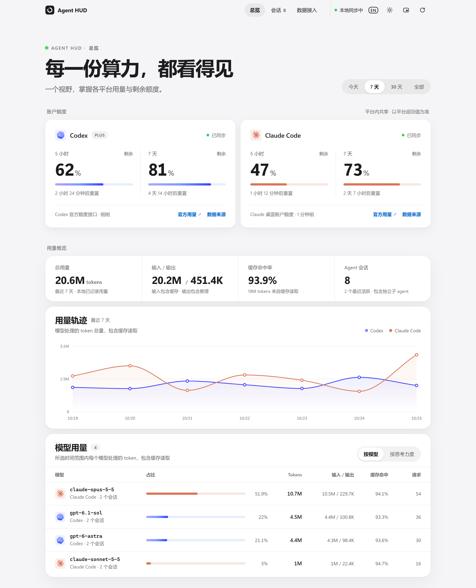

  

<h1 align="center">Agent HUD</h1>

  一眼看清 Codex 与 Claude Code 的用量和额度：本地完整面板 + Windows 毛玻璃桌面小组件。

  
  
  
  

  <a href="README.md">English</a> | 简体中文

  

  <picture>
    <source media="(prefers-color-scheme: dark)" srcset="docs/images/dashboard-dark-zh.png">
    
  </picture>
   
  截图使用演示数据。

## 亮点

- 🪟 **桌面小组件**：毛玻璃横条实时模糊背后的内容，品牌色圆环显示剩余百分比和各自的重置时间。
- 📊 **完整面板**：账户额度、token 用量、缓存命中率、7 天用量轨迹、按模型或思考力度的用量和每个 agent 会话，支持浅色与深色。
- 🔒 **只在本机**：读取你自己的 Codex / Claude Code 日志，仅绑定 127.0.0.1，不保存提示词或登录凭据。
- 📌 **不打扰**：一键置顶、靠近屏幕边缘自动贴边，服务停了会自己重启。
- 🌐 **中文 / English**：面板默认跟随浏览器语言，小组件默认跟随 Windows 语言，都能一键切换。

## 快速开始

需要 Windows 10/11、Node.js 22+（Windows 建议 24.5+），以及本机使用过的 Codex 和/或 Claude Code。

**完整面板：** 右键 `start.ps1`，选择用 PowerShell 运行；或在项目目录运行 `powershell -ExecutionPolicy Bypass -File .\start.ps1`。启动器在后台启动服务并打开浏览器，用 `stop.ps1` 停止它创建的服务。也可以直接运行 `node server.mjs`，打开 http://127.0.0.1:4318，按 Ctrl+C 停止。设置环境变量 `PORT` 可更换端口。

**桌面小组件：** 运行 `powershell -ExecutionPolicy Bypass -File desktop/build.ps1` 构建，然后启动 `desktop\bin\AgentHUD.exe`（可以为它创建桌面或任务栏快捷方式）。小组件会自动启动本地服务，无需先运行 `start.ps1`。

面板右上角可切换语言（EN / 中）、切换外观（跟随系统 / 浅色 / 深色），也可打开紧凑窗口（浏览器是否置顶由系统/浏览器决定）。语言在手动选择前跟随浏览器，选择会被保存；本地服务发来的状态文字也会一并翻译。

## 数据与计数

- Codex：增量读取 `~/.codex/sessions/**/*.jsonl`，从 `session_index.jsonl` 读取标题。优先使用 `token_usage_record` 的请求用量，老版本退回 `token_count` 累计值差分。按 response ID 去重，排除其他 thread 的继承记录，识别父子 agent。
- Claude Code：增量读取 `~/.claude/projects/**/*.jsonl`。按 message ID 合并同一响应的流式记录，跨复制/续接会话去重，读取子 agent 文件。
- 输入包含缓存读取和写入；输出包含推理。缓存和推理不能再次加到合计中。跨平台统一口径为 `input + output`。
- “模型用量”按每次请求实际使用的模型累计，中途切换模型的会话会分别计入各个模型；它跟随时间范围、平台筛选和系统审查 agent 开关。
- 切到“按思考力度”后，同样的请求按模型和客户端记录的思考力度分组：Claude Code 在每条回复上记录，Codex 在每个回合记录。每行是一个模型的一档思考力度，档位下方注明对应模型，因此同一档位在不同模型上（包括 Codex 与 Claude Code 的 `xhigh`）分开显示。“思考 tokens”是输出中推理部分的用量；旧版客户端没有记录档位的请求显示为“未记录”。
- 默认隐藏系统审查 agent；可在表格下方开启。系统审查 token 记录不等于订阅额度消耗。
- 统计范围包含本机尚未归档的会话。不是全部云端活动，不是账单。显示的“最近活跃”基于 2 分钟内的记录，不是进程检测。
- 日期范围和图表采用 America/New_York 时区。账户额度始终是平台自身的窗口，不受 token 统计日期筛选影响。

## Codex 账户额度

通过官方 App Server 的只读 `account/rateLimits/read` 每分钟刷新，不发起模型请求。复用 Codex 自身的登录流程；应用不读取、存储或输出登录密钥。连接失败时显示最近会话里的真实额度快照，并标注来源和时间。超过重置时间显示等待更新，不推断为 100%。

可设置 `CODEX_BINARY` 指向 Codex 可执行文件，`CODEX_HOME` 指定会话目录。`AGENT_HUD_DISABLE_RPC=1` 可仅使用本地快照。

参考：[Codex 官方 App Server 文档](https://learn.chatgpt.com/docs/app-server)。

## Windows 桌面小组件

小组件直接启动 `desktop/bin/AgentHUD.exe`，启动后会自动恢复本地额度服务。早期版本通过 `Agent HUD.vbs` 和 `start-widget.ps1` 启动，曾被杀毒软件（Norton）拦截，因此当前入口不再依赖脚本。新编译的程序首次运行时，部分杀毒软件会先扫描数十秒才放行。

小组件是 304 × 48 DIP 的毛玻璃横条：实时模糊背后的内容，使用 Windows 11 原生圆角，随 Windows 显示缩放调整，接近默认任务栏高度，并跟随 Windows 应用的浅色/深色主题（与完整面板一致）。系统关闭“透明效果”时改用不透明底色。圆环使用两家的品牌色（Codex 蓝紫渐变、Claude 陶土橙），中心是各自的标志，旁边显示剩余百分比；低于 20% 时百分比变红。

按住空白处拖动可移动，松手时靠近屏幕工作区边缘会贴边，并自动保存显示器及相对位置。恢复位置会避开任务栏和多屏之间的空隙；显示器或缩放变化后重新校正，找不到原屏幕时回到主屏。⋯ 菜单和托盘菜单均提供“重置小组件位置”。

右侧 `5h` / `7d` 切换额度周期。百分比下方显示额度重置时间：一天内显示具体时刻（如“14:30 重置”），更远时显示星期（如“周四重置”，跨到下周同一天为“下周四重置”）；离线时此处显示“离线”，平台未提供重置时间时显示平台名。悬停圆环可查看额度的实际采集时间、多久前更新、重置倒计时、完整日期与来源。本地快照每 5 秒读取一次，Codex 官方额度正常约每分钟查询、Claude 桌面额度正常约每 5 分钟查询，连接失败时可能延迟。未知时间不会显示成“刚刚”。

蓝色实心图钉表示已置顶，带斜线的空心图钉表示未置顶；点一下图钉即切换置顶，再点一下取消。`5h` / `7d` 右边的 ⋯ 打开菜单，可切换置顶、打开面板或 Codex / Claude 官方用量页、收起至托盘、重置位置或退出。

小组件支持中文和英文：默认跟随 Windows 显示语言；点图钉左边的 **EN** / **中** 按钮（或托盘菜单中的“Switch to English / 切换到中文”）可立即切换，选择会被保存。本地服务发来的状态文字（额度来源、连接提示）也会一并翻译。

本地服务离线时边缘变橙并显示“离线”，小组件在连续两次读取失败后自动用 `start.ps1` 重启服务（最多每分钟一次）。值和显示状态未变化时不重复重绘圆环；收起后停止界面更新和动画，继续获取数据，恢复时立即显示最新快照。托盘与退出信号由事件唤醒，不再每秒轮询。

界面视觉遵循 [apple-design-skill](https://github.com/naplesblue/apple-design-skill) 的规范：灰白底、白色面板与发丝分隔线、灰阶层级加单一蓝色强调，玻璃只用于导航、弹窗和悬浮的小组件。

桌面程序使用 Windows 自带 .NET Framework 构建，不需要安装额外桌面运行时。启动入口复用已构建的程序，不执行源码检查和自动重编译。修改源码后，请先从小组件菜单退出，再运行 `powershell -ExecutionPolicy Bypass -File desktop/build.ps1`，然后重新启动。`desktop/build-support.ps1` 中的内容指纹、临时目录构建与有序替换逻辑仍保留，供开发和回归测试使用。启动诊断记录在 `.data/widget-startup.log`，程序错误记录在 `.data/widget-error.log`。

## Claude 账户额度

### Windows 桌面账户连接

桌面版账户读取通道默认关闭。它仅在内存中读取当前 Windows 用户的 Claude 加密 OAuth 缓存，匹配当前账户和唯一组织，并向固定地址 `https://api.anthropic.com/api/oauth/usage` 发送 GET。此额度由同一账户的桌面版、网页版和 CLI 共享，不依赖状态栏回调，也不发起模型请求。

明确允许此连接后，运行 `node scripts/connect-claude-desktop.mjs --enable`，然后重启 HUD 服务。关闭连接使用同一命令的 `--disable`。开关保存在本项目 `.data/claude-desktop-connection.json`，默认缺失时不会读取任何登录凭据或请求 Claude 额度。

正常每 5 分钟查询，限流时至少等待 15 分钟。HUD 不保存访问令牌、不记录接口原始响应、不修改 Claude 配置、不刷新或轮换令牌；连接过期时需打开 Claude，由原应用续期。多组织无法确定归属时停止读取，防止显示错账户的额度。断线时标注历史快照，注销或账户连接失效时清空旧值。

兼容 Windows 独立安装与 Microsoft Store 的 Claude 数据目录，包括新版 Claude 迁移后的 `%LOCALAPPDATA%\Claude-Data` 目录（优先读取）。依据本机桌面应用的内部接口实现，并非厂商公开承诺稳定的第三方 API，应用更新后可能需要适配。已用真实账户在 Microsoft Store 桌面版上验证，可取得 5 小时和 7 天额度及重置时间。

Windows 上建议使用 Node.js 24.5+；HUD 会同时使用 Node 默认证书和 Windows 系统可信证书库，保持完整 HTTPS 校验。

### 终端状态栏桥接

运行 `node scripts/connect-claude.mjs` 接入官方状态栏。脚本备份 `~/.claude/settings.json` 后只添加 `statusLine`；已存在其他自定义状态栏时会停止，避免覆盖。可使用 `CLAUDE_CONFIG_DIR` 指向其他 Claude 配置目录。

此桥接适用于**终端中的 Claude Code CLI**。重新打开 CLI 后，正常模型响应会触发状态栏，HUD 读取其中的平台额度。无需为 HUD 额外发送请求。字段是否出现取决于 Claude Code 版本和账户类型；未提供时保留未知状态，不根据 token 推算。

终端桥接不会被本机的 Claude 桌面会话调用，安装它本身不代表桌面额度已接入。桌面版应使用上述账户连接。HUD 保留 [Claude 官方用量页](https://claude.ai/settings/usage) 入口，桌面版会话的 token 记录也仍可统计。

状态栏桥接仅把 session ID、额度窗口、上下文数值、采集时间写入本项目 `.data`。它不会保存完整 stdin、提示词或凭据。卸载桥接：`node scripts/connect-claude.mjs --remove`，保留其他配置不变。

已有状态栏时，可在自己的状态栏脚本中把同一份 stdin JSON 传给 `scripts/claude-statusline.mjs`，忽略其 stdout，以保留原显示。

参考：[Claude Code 官方状态栏文档](https://code.claude.com/docs/en/statusline)。

## 隐私与实现

服务仅绑定 127.0.0.1，拒绝跨域和陌生 Host。浏览器接收会话标题、项目短名称、模型和用量，不包含原始对话、工具输出、文件路径或登录信息。解析时仅保留计数和元数据；会话文件只读。`.data` 已加入 Git 忽略。

前端每 5 秒获取快照；后台增量扫描新增日志，容忍半行 JSON。Codex 官方额度约每分钟查询，Claude 桌面额度正常约每 5 分钟查询。数据缺失、陈旧、断连都有独立状态。

其他平台可通过 `lib/collector.mjs` 增加适配器，复用 `lib/metrics.mjs` 中的统一会话/请求/额度结构。目前真正接入的只有 Codex 与 Claude Code，不展示模拟平台。

## 验证

`npm test` 或 `node --test test/*.test.mjs`。测试包含缓存口径、推理不重复、流式响应去重、继承记录排除、空额度、重置时间与增量读取。

Windows 桌面回归：`powershell -ExecutionPolicy Bypass -File desktop/test.ps1`。测试会短暂显示独立测试窗口，在 `.data/desktop-tests` 下使用独立状态，不修改实际小组件的位置与设置。覆盖置顶恢复、图钉点击切换、⋯ 菜单及其弹出位置、语言按钮、不抢焦点、托盘显示与退出信号、更新时间与重置时间显示、屏幕空隙/负坐标/断屏/缩放后的定位计算、真实窗口越界校正、隐藏停止渲染及未变化的圆环不重绘。真实多屏热插拔和不同显示器 DPI 间的拖动仍需在相应硬件上验收。

自动更新回归：`powershell -ExecutionPolicy Bypass -File desktop/test-launcher.ps1`，使用临时项目与后台测试进程，覆盖首次构建、跳过未变化的源码、时间戳不变时的内容检测、有序替换、编译失败保留旧进程与旧程序；兼容 Windows PowerShell 5.1。

## 许可

本项目以 MIT 许可发布，见 [LICENSE](LICENSE)。小组件与面板中的 Codex、Claude 标志图形来自 [LobeHub Icons](https://github.com/lobehub/lobe-icons)（MIT）；这些标志是 OpenAI 与 Anthropic 的商标，不随本项目的 MIT 许可授予。
